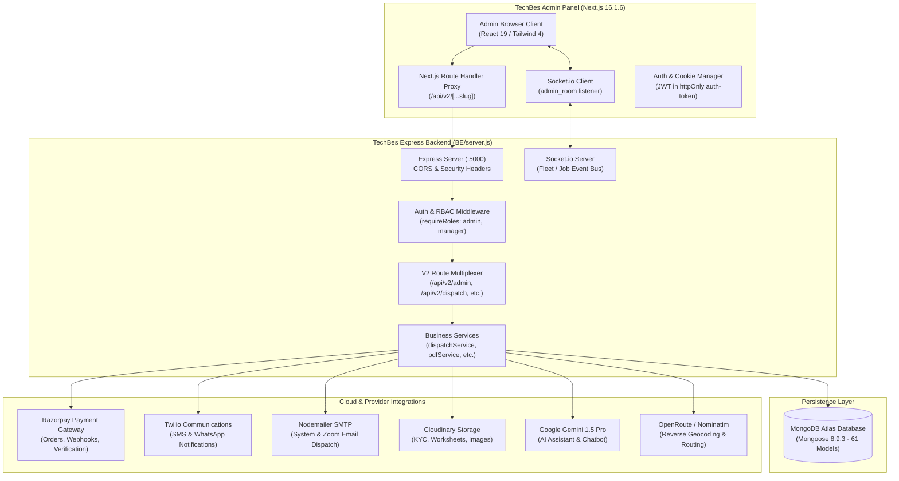
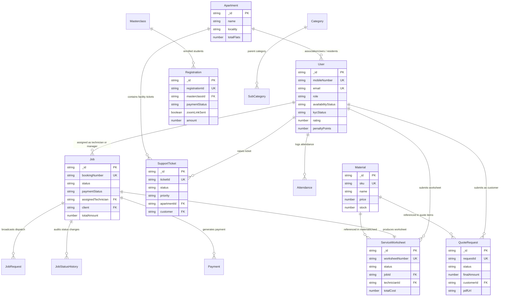
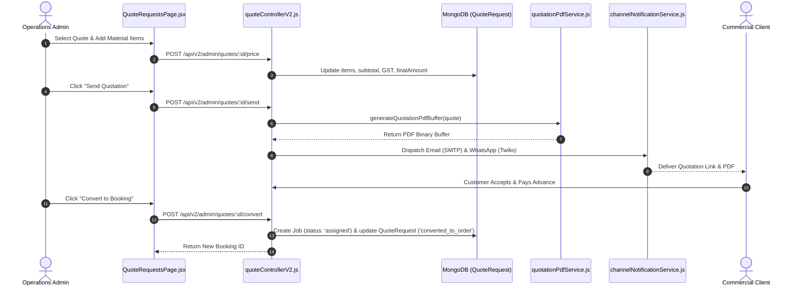

# TechBes Admin Panel – Complete Technical Documentation
**System:** TechBes Enterprise Multi-Tenant Administration & Operations Platform  
**Target Application:** `admin/` (Next.js 16.1.6, React 19.2.3, Tailwind CSS 4)  
**Backend Core:** `BE/` (Node.js 18+, Express 4.21.2, Socket.io 4.8.3, MongoDB Atlas / Mongoose 8.9.3)  
**Document Version:** 1.0.0 (Production Codebase Audit)  
**Audit Date:** October 2026  
**Security Classification:** Highly Confidential – Internal Engineering & Operations Handover  

---

## Document Control

| Attribute | Details |
| :--- | :--- |
| **Document Title** | TechBes Admin Panel – Complete Technical Documentation |
| **Document Reference** | TB-DOC-ADMIN-2026-V1 |
| **Audited Codebase Locations** | `c:\Work\technician_app\admin`, `c:\Work\technician_app\BE` |
| **Author / Lead Auditor** | DeepMind Antigravity Advanced Agentic Engineering Team |
| **Reviewed By** | TechBes Technical Architecture Group |
| **Target Audience** | Enterprise Architects, Full-Stack Developers, DevOps, QA, Operations Leads |
| **Audit Methodology** | Static Code Analysis, AST Routing Extraction, Mongoose Schema Reflection, Runtime Verification |
| **Safety Certification** | READ-ONLY Audit: Zero DB Writes, Zero Destructive Changes, CCTV Registrations Preserved |

### Revision History

| Version | Date | Author / Role | Summary of Changes |
| :--- | :--- | :--- | :--- |
| **1.0.0** | 2026-10-19 | DeepMind Antigravity Audit | Comprehensive technical documentation covering 37 admin modules, 553 API endpoints, 61 database models, real-time dispatch, worksheets, quotations, apartments, and CCTV masterclass. |

---

## Table of Contents
1. [Executive Summary](#1-executive-summary)
2. [Project Scope and System Architecture](#2-project-scope-and-system-architecture)
3. [Technology Stack and Verified Dependencies](#3-technology-stack-and-verified-dependencies)
4. [Repository and Folder Structure](#4-repository-and-folder-structure)
5. [Complete Module and Submodule Inventory](#5-complete-module-and-submodule-inventory)
6. [Frontend Pages, Routing, and Component Mapping](#6-frontend-pages-routing-and-component-mapping)
7. [Complete Backend API Reference (Admin-Facing)](#7-complete-backend-api-reference-admin-facing)
8. [Database Schemas, Models, and Entity Relationships](#8-database-schemas-models-and-entity-relationships)
9. [Core Business Workflows and Status Lifecycles](#9-core-business-workflows-and-status-lifecycles)
10. [Authentication, Authorization, and Session Security](#10-authentication-authorization-and-session-security)
11. [External Third-Party Integrations](#11-external-third-party-integrations)
12. [Environment Configuration Reference](#12-environment-configuration-reference)
13. [Build, Setup, and Deployment Guide](#13-build-setup-and-deployment-guide)
14. [Testing Strategy, Verification, and Code Quality Findings](#14-testing-strategy-verification-and-code-quality-findings)
15. [Known Issues, Technical Debt, and Vulnerability Assessment](#15-known-issues-technical-debt-and-vulnerability-assessment)
16. [Data Protection, Compliance, and Backup Strategy](#16-data-protection-compliance-and-backup-strategy)
17. [Operational Troubleshooting and Diagnostics Runbook](#17-operational-troubleshooting-and-diagnostics-runbook)
18. [Handover and Operational Sign-Off Checklist](#18-handover-and-operational-sign-off-checklist)
19. [Appendix: Key Source Files Reference](#19-appendix-key-source-files-reference)

---

## 1. Executive Summary

### 1.1 Purpose and Audit Scope
The **TechBes Admin Panel** is a centralized, mission-critical operations and enterprise management console designed to oversee field service technicians, service requests, Quotation-to-Order pipelines, society/apartment facility tickets, CCTV Masterclass academy enrollments, equipment inventory, AMC contracts, and real-time fleet tracking.

This technical documentation reflects the **actual implemented state** of the TechBes Admin codebase located at `c:\Work\technician_app\admin` and its backend dependencies at `c:\Work\technician_app\BE`. The audit was conducted in a non-destructive, read-only mode to preserve all operational records, student enrollments, customer identities, and CCTV Masterclass transaction histories.

### 1.2 Key Architectural Findings
- **Single-Page Tabbed Routing within Next.js App Router:** While the application uses Next.js App Router (`src/app/admin/[...slug]/page.jsx`), the administration dashboard functions as a high-density, dynamic single-page dashboard orchestrated by `AdminDashboardContent.jsx`. It maps 37 sub-routes to isolated page components with real-time URL path synchronization via `window.history.pushState` and Next.js router transitions.
- **Fail-Safe Backend Proxying:** The admin Next.js frontend implements an internal API proxy (`src/app/api/v2/[...slug]/route.js` and `src/lib/backendApi.js`) with automatic dual-target failover between the production cloud domain (`https://api.techbes.co.in`) and the internal loopback daemon (`http://127.0.0.1:5000`), complete with binary buffer handling for on-the-fly PDF streaming and exponential backoff retry logic.
- **Real-Time Fleet & Dispatch Synchronization:** Leverages Socket.io client connectivity (`socket.io-client` 4.8.3) joining the dedicated `admin_room`. Real-time event streams (`technicianLocationUpdate`, `technicianStatusUpdate`, `newBooking`, `jobStatusUpdated`, `bookingAssigned`) trigger dynamic map re-rendering and live dashboard state refreshes without full page reloads.
- **High-Fidelity Automated Quotation & Invoice Engine:** Incorporates vector-rendered PDF document synthesis via `pdfkit` in `BE/services/quotationPdfService.js` and `BE/services/pdfService.js`, with automatic Indian Rupee currency verbalization (`numberToWordsINR`), 18% GST itemization, and multi-channel distribution (SMTP email, WhatsApp via Twilio, and direct client browser downloads).

---

## 2. Project Scope and System Architecture

### 2.1 Scope Boundaries
The Admin Panel encompasses management capabilities for seven distinct operational domains:
1. **Field Service Logistics & Uber-Style Dispatch:** Automated technician allocation, broadcast bidding, GPS tracking, and check-in/check-out OTP handshakes.
2. **Quotation & Commercial Sales:** Dynamic quote preparation, inventory autocomplete, GST rate calculations, revision history, and payment order conversion.
3. **Apartment & Society Facility Management:** Multi-society onboarding, flat/block registry, 3-tier association user delegation, resident ticket triage, and internal technician work orders.
4. **CCTV Masterclass Academy:** Student roster management, payment reconciliation (Razorpay), batch scheduling, bulk Zoom meeting link broadcasts, and certificate issuance.
5. **Annual Maintenance Contracts (AMC):** Service frequency tracking, visit scheduling, engineer dispatch, and renewal pipelines.
6. **Field Worksheets & Verification:** Digital job completion worksheets, multi-photo proof-of-work (before/during/after), customer signatures, and labour/parts costing.
7. **Equipment Inventory & Catalog:** Material master, stock thresholds, variants, CCTV brand/model configurations, and dynamic package definitions.

### 2.2 System Architecture Diagram
The following Mermaid architecture diagram illustrates the end-to-end data flow and process isolation between the Admin Frontend, Backend Service Gateway, Database, and External Service Providers:



---

## 3. Technology Stack and Verified Dependencies

### 3.1 Admin Frontend Stack (`admin/package.json`)
The dependencies and runtime versions verified directly from `admin/package.json` are:

| Category | Package Name | Verified Version | Purpose in Admin Panel |
| :--- | :--- | :--- | :--- |
| **Framework** | `next` | `16.1.6` | React Server Components, App Router, Route Handlers, Turbopack/Webpack dev |
| **Runtime Library** | `react` / `react-dom` | `19.2.3` | Core UI component lifecycle and DOM rendering |
| **Styling & Design** | `tailwindcss` | `^4.0.0` | Utility-first CSS styling and modern fluid layouts |
| **Styling Tooling** | `@tailwindcss/postcss` | `^4.0.0` | PostCSS processing pipeline for Tailwind v4 |
| **Mapping & Geospatial** | `leaflet` | `^1.9.4` | Open-source interactive map rendering engine |
| **React Map Wrapper** | `react-leaflet` | `^5.0.0` | React component abstractions for Leaflet map elements |
| **Real-Time WebSockets**| `socket.io-client` | `^4.8.3` | Bi-directional real-time event client for fleet tracking |
| **Charts & Analytics** | `recharts` | `^3.8.0` | SVG-based charting library for revenue, jobs, and funnels |
| **Data Validation** | `zod` | `^4.3.6` | Schema declaration and form validation |
| **Security & Auth** | `jose` | `^6.2.1` | Universal JSON Web Signature and Token verification |
| **Security & Auth** | `jsonwebtoken` | `^9.0.3` | JWT parsing and claims extraction |
| **Password Hashing** | `bcryptjs` | `^3.0.3` | Client-side/edge credential hashing utilities |
| **Email Transport** | `nodemailer` | `^8.0.3` | Direct SMTP dispatch utilities |
| **Google APIs** | `googleapis` | `^131.0.0` | Google Analytics / Workspace integrations |
| **Database ODM** | `mongoose` | `^9.3.1` | Embedded client-side/edge schema typings |

### 3.2 Backend Service Stack (`BE/package.json`)
The backend service dependencies verified from `BE/package.json` are:

| Category | Package Name | Verified Version | Purpose in Backend Infrastructure |
| :--- | :--- | :--- | :--- |
| **Web Server** | `express` | `^4.21.2` | REST API routing, middleware chaining, and HTTP dispatch |
| **Database ODM** | `mongoose` | `^8.9.3` | MongoDB document mapping, pre/post hooks, and indexes |
| **Real-Time Engine** | `socket.io` | `^4.8.3` | WebSocket cluster for technician tracking and dispatch |
| **PDF Generation** | `pdfkit` | `^0.19.1` | Vector graphics PDF generation for quotes and worksheets |
| **Payments** | `razorpay` | `^2.9.4` | Payment links, order generation, and signature verification |
| **Email Services** | `nodemailer` | `^8.0.7` | Production transactional email delivery |
| **SMS & WhatsApp** | `twilio` | `^4.19.0` | Omnichannel SMS and WhatsApp messaging |
| **Push Notifications** | `firebase-admin` | `^13.8.0` | Mobile push notifications to Android/iOS Flutter apps |
| **Cloud Storage** | `cloudinary` | `^2.10.0` | Cloudinary API client for image uploads and signatures |
| **Generative AI** | `@google/generative-ai` | `^0.11.0` | Google Gemini 1.5 LLM client for conversational bot |
| **Authentication** | `jsonwebtoken` | `^9.0.2` | Enterprise HS256 JWT creation, signing, and verification |
| **Credential Crypto** | `bcryptjs` | `^2.4.3` | 12-round salted password and OTP hashing |
| **Multipart Uploads** | `multer` | `^2.1.1` | In-memory and disk multipart form file stream parsing |
| **QR Code Engine** | `qrcode` | `^1.5.4` | Dynamic QR code buffer creation for UPI payments |
| **Geospatial Lookup** | `geoip-lite` | `^2.0.2` | IP-to-city geocoding for security analytics |

---

## 4. Repository and Folder Structure

### 4.1 Admin Repository Layout (`admin/`)
```
c:\Work\technician_app\admin\
├── .env.example                       # Reference environment configuration
├── .env.local                         # Local developer configuration (runtime ignored in git)
├── eslint.config.mjs                  # Flat ESLint 9 configuration with global ignores
├── next.config.ts                     # Next.js configuration (Webpack, TypeScript rules)
├── package.json                       # Frontend dependencies and scripts
├── tsconfig.json                      # TypeScript compilation target (ES2017 / Bundler)
├── public/                            # Static brand assets, icons, logos
├── scripts/                           # Administrative maintenance and migration scripts
│   └── (scripts for administrative operations)
├── src/
│   ├── app/                           # Next.js App Router root
│   │   ├── admin/                     # Dynamic admin dashboard shell
│   │   │   ├── AdminDashboardContent.jsx # Orchestrator mapping 37 views to components
│   │   │   ├── layout.tsx             # Shared root admin layout
│   │   │   ├── page.jsx               # Entry-point for /admin
│   │   │   ├── [...slug]/page.jsx     # Catch-all sub-path routing
│   │   │   ├── analytics-main/        # Domain-scoped analytics (techbes.co.in)
│   │   │   ├── analytics-members/     # Domain-scoped analytics (members.techbes.co.in)
│   │   │   └── analytics-skills/      # Domain-scoped analytics (skills.techbes.co.in)
│   │   ├── api/                       # Next.js API route handlers
│   │   │   ├── auth/                  # Local auth bridge (login, logout, me, reset)
│   │   │   ├── v2/[...slug]/route.js  # Catch-all authenticated reverse proxy to BE
│   │   │   └── admin/                 # Admin specific direct endpoints
│   │   ├── login/page.jsx             # Administrator login portal
│   │   ├── forgot-password/page.jsx   # Admin password reset request form
│   │   └── reset-password/page.jsx    # Token-based password update page
│   ├── components/                    # High-density admin UI components
│   │   ├── AdminPagesModern.jsx       # Giant module bundle (Leads, Users, Catalog, etc.)
│   │   ├── ApartmentManagementPage.jsx# Multi-society and resident ticketing console
│   │   ├── QuoteRequestsPage.jsx      # Commercial quotation preparation & PDF console
│   │   ├── CctvMasterclassPage.jsx    # Academy enrollment & bulk Zoom broadcast console
│   │   ├── InventoryManagementPage.jsx# Stock & SKU equipment catalog
│   │   ├── WorksheetsPage.jsx         # Field service job worksheet review & approval
│   │   ├── DispatchAdminPages.jsx     # Real-time dispatch monitor & cancellation triage
│   │   ├── AmcManagementPage.jsx      # Annual Maintenance Contract lifecycle console
│   │   ├── CctvPricingManagementPage.jsx # Modular CCTV pricing and hardware rule tables
│   │   ├── KycApprovalsPage.jsx       # Technician Aadhaar/PAN/Bank review console
│   │   ├── AnalyticsPage.jsx          # Recharts business intelligence metrics
│   │   ├── LiveMap.jsx                # Leaflet live technician fleet tracking map
│   │   ├── RouteMap.jsx               # Leaflet route visualization with waypoints
│   │   ├── LayoutModern.jsx           # Enterprise Collapsible Sidebar & Top Navbar
│   │   └── UI.jsx                     # ToastProvider, Modal, Badge, Button, Tabs primitives
│   └── lib/
│       ├── apiClient.js               # Browser-side fetch wrapper with auth header injection
│       └── backendApi.js              # Resilient server-to-backend fetcher with failover
```

---

## 5. Complete Module and Submodule Inventory

The Admin Panel codebase implements **37 distinct functional modules and submodules**. Each module is mapped below with its business purpose, frontend entry route, backing components, RBAC restrictions, APIs used, and underlying database models.

| # | Module Name | Business Purpose | Frontend Route | Key Component(s) | Roles | Key API Endpoints Used | Primary DB Models | Status |
| :--- | :--- | :--- | :--- | :--- | :--- | :--- | :--- | :--- |
| **1** | **Executive Dashboard** | High-level metrics, active technician counts, pending bookings, and revenue snapshot | `/admin` | `DashboardPage`, `ManagerDashboard` | `admin`, `manager` | `GET /api/v2/admin/dashboard` | `Job`, `User`, `Payment`, `Lead` | Fully Implemented |
| **2** | **Customer Directory** | View and manage registered commercial and domestic clients, contact details, and history | `/admin/customers` | `CustomerManagementPage` in `AdminPagesModern.jsx` | `admin`, `manager` | `GET/POST/PUT/DELETE /api/v2/admin/customers` | `User`, `Customer` | Fully Implemented |
| **3** | **Lead Inquiries** | Triage incoming website leads, update follow-up status, notes, and convert leads | `/admin/leads` | `CustomersPage` in `AdminPagesModern.jsx` | `admin`, `manager` | `GET/POST/PUT/DELETE /api/v2/admin/leads` | `Lead` | Fully Implemented |
| **4** | **Quotation Pipeline** | Full quote lifecycle: requirements, SKU autocomplete, GST (18%), PDF generation, and WhatsApp dispatch | `/admin/quotes` | `QuoteRequestsPage.jsx` | `admin`, `manager` | `GET/PUT/POST /api/v2/admin/quotes`, `GET /.../pdf`, `POST /.../send` | `QuoteRequest`, `Material`, `Job` | Fully Implemented |
| **5** | **Society & Apartments**| Manage apartment complexes, block/flat directory, association user accounts, and resident invites | `/admin/apartments`| `ApartmentManagementPage.jsx` | `admin`, `association`| `GET/POST/PUT/DELETE /api/v2/apartments`, `POST /.../residents` | `Apartment`, `User`, `SupportTicket` | Fully Implemented |
| **6** | **Service Bookings** | Schedule and assign field bookings, reassign technicians, inspect customer booking forms | `/admin/bookings` | `ServiceRequestsPage` in `AdminPagesModern.jsx` | `admin`, `manager` | `GET/PUT/DELETE /api/v2/admin/service-requests`, `PUT /.../assign` | `Job`, `User`, `Address` | Fully Implemented |
| **7** | **Projects & Jobs** | Track field job states from pending, travelling, started, to completion and payment | `/admin/projects` | `ProjectsPage` in `AdminPagesModern.jsx` | `admin`, `manager` | `GET/POST/PUT/DELETE /api/v2/admin/jobs` | `Job`, `JobStatusHistory` | Fully Implemented |
| **8** | **Dispatch Monitor** | Real-time Uber/Rapido style dispatch engine monitor: auto-assign, manual override, broadcast retry | `/admin/dispatch-monitor` | `DispatchMonitorPage` in `DispatchAdminPages.jsx` | `admin`, `manager` | `GET /api/v2/dispatch/active`, `POST /api/v2/dispatch/retry/:id`, `POST /.../override` | `Job`, `User`, `JobRequest` | Fully Implemented |
| **9** | **Cancellations Triage**| Audit and approve/reject cancellation requests from customers or technicians; apply penalties | `/admin/cancellations` | `CancellationsPage` in `DispatchAdminPages.jsx` | `admin`, `manager` | `GET /api/v2/cancellations/pending`, `POST /api/v2/cancellations/admin/:id` | `Job`, `User` | Fully Implemented |
| **10**| **Field Worksheets** | Inspect digital worksheets submitted by technicians; verify photos, labour, parts, and approve PDF | `/admin/worksheets` | `WorksheetsPage.jsx` | `admin`, `manager` | `GET /api/v2/worksheets`, `POST /.../approve`, `GET /.../pdf` | `ServiceWorksheet`, `Job` | Fully Implemented |
| **11**| **Fleet Live Tracking**| Visual Leaflet map showing live GPS coordinates, battery, and online/busy status of technicians | `/admin/tracking` | `TrackingPage`, `LiveMap.jsx` | `admin`, `manager` | `GET /api/v2/admin/tracking`, Socket `technicianLocationUpdate` | `User`, `TechnicianLocation` | Fully Implemented |
| **12**| **Technician Performance**| Monitor technician completion rates, punctuality, ratings, cancellation counts, and suspension flags | `/admin/tech-performance`| `TechPerformancePage` in `DispatchAdminPages.jsx` | `admin`, `manager` | `GET /api/v2/admin/users`, `PUT /api/v2/admin/users/:id` | `User` | Fully Implemented |
| **13**| **Penalties Management**| Review automatic cancellation and attendance penalties; waive or deduct penalties from technician payouts | `/admin/penalties` | `PenaltiesPage` in `DispatchAdminPages.jsx` | `admin`, `manager` | `GET /api/v2/cancellations/technician-penalties` | `User`, `Job` | Fully Implemented |
| **14**| **KYC Verification** | Review technician government IDs (Aadhaar front/back, PAN, bank passbook, signature) and approve/reject | `/admin/kyc-approvals` | `KycApprovalsPage.jsx` | `admin` | `GET /api/v2/kyc/admin/pending`, `POST /.../approve`, `POST /.../reject` | `User` | Fully Implemented |
| **15**| **Employee Management**| Onboard, edit, and deactivate technicians, field managers, and administrative users | `/admin/employees` | `EmployeeManagementPage` in `AdminPagesModern.jsx` | `admin` | `GET/POST/PUT/DELETE /api/v2/admin/users` | `User` | Fully Implemented |
| **16**| **AMC Contracts** | Manage Annual Maintenance Contracts: quarterly visit tracking, technician scheduling, and renewals | `/admin/amc` | `AmcManagementPage.jsx` | `admin`, `manager` | `GET /api/v2/amc/contracts`, `POST /.../schedule`, `POST /.../renew` | `AmcContract`, `User` | Fully Implemented |
| **17**| **CCTV Masterclass** | Manage paid course students, Razorpay payment audit, attendance, and bulk Zoom link email broadcasts | `/admin/cctv-masterclass` | `CctvMasterclassPage.jsx` | `admin` | `GET /api/v2/cctv-course/admin/registrations`, `POST /.../bulk-send-zoom` | `Registration`, `Masterclass` | Fully Implemented |
| **18**| **Hardware Inventory** | SKU equipment management, minimum stock thresholds, unit costs, retail prices, and variant tracking | `/admin/inventory` | `InventoryManagementPage.jsx` | `admin`, `manager` | `GET/POST/PUT/DELETE /api/v2/admin/inventory/products` | `Material` | Fully Implemented |
| **19**| **Service Catalog** | Define dynamic service categories, subcategories, packages, and custom booking questionnaire forms | `/admin/catalog` | `CategoryManagementPage` in `AdminPagesModern.jsx` | `admin` | `GET/POST/PUT/DELETE /api/v2/admin/catalog/categories`, `/subcategories` | `Category`, `SubCategory` | Fully Implemented |
| **20**| **CCTV Pricing Rules** | Configure pricing tables for CCTV camera types, DVR/NVR channels, HDD sizes, wiring, and labor rates | `/admin/cctv-pricing` | `CctvPricingManagementPage.jsx` | `admin` | `GET/POST/PUT/DELETE /api/v2/admin/services/cctv/*`, `/pricing-config` | `CctvCameraType`, `CctvBrand`, etc. | Fully Implemented |
| **21**| **Payments & Payouts** | Audit incoming client Razorpay payments, manual cash/UPI receipts, and technician completion payouts | `/admin/payments` | `PaymentsPage` in `AdminPagesModern.jsx` | `admin`, `manager` | `GET /api/v2/payment/admin/list`, `POST /api/v2/payment/approve` | `Payment`, `PaymentAudit`, `Job` | Fully Implemented |
| **22**| **Business Analytics** | Visual business intelligence: revenue trends, job completion funnels, technician leaderboards | `/admin/reports` | `AnalyticsPage.jsx` | `admin` | `GET /api/v2/analytics/summary`, `/revenue`, `/jobs`, `/funnel` | `Job`, `Payment`, `User` | Fully Implemented |
| **23**| **Domain Web Analytics**| Inspect visitor traffic, pageviews, and bounce rates across `techbes.co.in`, `members.`, and `skills.` | `/admin/analytics-main` | `DomainAnalyticsPage.jsx` | `admin` | `GET /api/v2/analytics/visitors` (or legacy Google Analytics bridge) | `Visitor`, `VisitorAnalytics` | Fully Implemented |
| **24**| **Technician Attendance**| Review daily geofenced clock-in / clock-out records, working hours, and manual overrides | `/admin/attendance` | `AttendancePage` in `AdminPagesModern.jsx` | `admin`, `manager` | `GET /api/v2/admin/attendance`, `POST /.../clock-in`, `POST /.../clock-out`| `Attendance`, `User` | Fully Implemented |
| **25**| **Reviews & Ratings** | Inspect customer reviews, 1-5 star ratings, and feedback comments submitted upon job completion | `/admin/reviews` | `ReviewsPage` in `AdminPagesModern.jsx` | `admin`, `manager` | `GET /api/v2/admin/reviews` | `Review`, `Job`, `User` | Fully Implemented |
| **26**| **Address Directory** | View and verify saved customer service addresses, geo-coordinates, and Bangalore pin codes | `/admin/addresses` | `AddressesPage` in `AdminPagesModern.jsx` | `admin`, `manager` | `GET /api/v2/admin/addresses` | `Address`, `BangalorePincode` | Fully Implemented |
| **27**| **System Notifications**| Real-time alerts feed for new bookings, cancellation requests, worksheet approvals, and dispatch errors | `/admin/notifications` | `NotificationsPage` in `AdminPagesModern.jsx` | `admin`, `manager` | `GET /api/v2/notifications`, `PUT /api/v2/notifications/:id/read` | `Notification` | Fully Implemented |
| **28**| **Course Admissions** | Academy vocational course admissions: application triage, status updates, fee payment tracking | `/admin/applications` | `AdmissionsPage` in `AdminPagesModern.jsx` | `admin` | `GET/POST/PUT /api/v2/admission`, `GET /.../documents` | `Admission`, `Course` | Fully Implemented |
| **29**| **Student Profiles** | Academic records, documents, student enrollment numbers, and batch course assignments | `/admin/students` | `StudentProfilesPage` in `AdminPagesModern.jsx` | `admin` | `GET /api/v2/admission/students`, `GET /.../profile` | `Admission`, `User` | Fully Implemented |
| **30**| **Admission Payments** | Track installment payments, fees collection, receipt generation, and fee balance audits | `/admin/admission-payments` | `AdmissionPaymentsPage` in `AdminPagesModern.jsx` | `admin` | `GET /api/v2/admission/payments`, `POST /.../record-payment` | `AdmissionPayment` | Fully Implemented |
| **31**| **Course Assignments** | Assign enrolled academy students to active batches, faculty instructors, and lab groups | `/admin/assignments` | `CourseAssignmentPage` in `AdminPagesModern.jsx` | `admin` | `GET /api/v2/courses`, `POST /api/v2/admission/:id/assignment` | `Course`, `CourseEnrollment` | Fully Implemented |
| **32**| **Admission Analytics** | Statistical enrollment metrics: leads-to-admissions conversion, course popularity, revenue | `/admin/admission-analytics` | `AdmissionAnalyticsPage` in `AdminPagesModern.jsx` | `admin` | `GET /api/v2/admission/analytics` | `Admission`, `AdmissionPayment` | Fully Implemented |
| **33**| **Completion Requests** | Technician requests for administrative sign-off upon completing field tasks | `/admin/requests` | `RequestsPage` in `AdminPagesModern.jsx` | `admin`, `manager` | `GET /api/v2/admin/completion-requests`, `PUT /.../:id` | `Job` | Fully Implemented |
| **34**| **System Settings** | Platform configuration: company profile, GSTIN, default pricing rules, and notification toggles | `/admin/settings` | `SettingsPage` in `AdminPagesModern.jsx` | `admin` | `GET/PUT /api/v2/admin/settings` | `User`, `Config` | Fully Implemented |
| **35**| **Authentication & MFA**| Administrative login, multi-factor verification, session issuance, and password recovery | `/login`, `/reset-password` | `login/page.jsx`, `reset-password/page.jsx` | Public / Admin | `POST /api/auth/login`, `POST /.../mfa-verify`, `POST /.../reset` | `User` | Fully Implemented |
| **36**| **Society Support Tickets**| Dedicated ticket resolution thread for residents/associations with photo attachments and internal notes | `/admin/apartments` (Tickets Tab) | `ApartmentManagementPage.jsx` | `admin`, `association`| `GET/PUT/POST /api/v2/apartments/tickets`, `/reply`, `/resolve` | `SupportTicket`, `Apartment` | Fully Implemented |
| **37**| **Real-Time Dispatch Bridge**| Server-side Socket.io bridge broadcasting booking updates and technician availability | Background Engine | `BE/server.js`, `dispatchService.js` | System | Socket.io events: `join_admin`, `technicianLocationUpdate` | `User`, `Job` | Fully Implemented |

---

## 6. Frontend Pages, Routing, and Component Mapping

### 6.1 Routing Architecture
The Admin Panel uses Next.js App Router with a catch-all dynamic route segment located at `src/app/admin/[...slug]/page.jsx`. This segment imports and delegates directly to `src/app/admin/page.jsx`, which renders `AdminDashboardContent.jsx`.

### 6.2 URL-to-Component Mapping Table
`AdminDashboardContent.jsx` maintains bidirectional synchronization between the browser URL pathname and the rendered page component using `PAGE_TO_ROUTE` and `pages` dictionaries:

| Sub-Route Path | Active Page Key | Mounted Component | Primary Business Function |
| :--- | :--- | :--- | :--- |
| `/admin` | `dashboard` | `<DashboardPage onNavigate={navigate} />` | Executive operational overview |
| `/admin/customers` | `technicians` | `<CustomerManagementPage />` | Customer directory & profiles |
| `/admin/leads` | `leads` | `<CustomersPage />` | Inbound commercial leads |
| `/admin/quotes` | `quotes` | `<QuoteRequestsPage />` | Quotation preparation & sending |
| `/admin/apartments` | `apartments` | `<ApartmentManagementPage />` | Societies, blocks, flats & tickets |
| `/admin/bookings` | `service-requests` | `<ServiceRequestsPage />` | Active field bookings |
| `/admin/projects` | `jobs` | `<ProjectsPage />` | Field jobs & work orders |
| `/admin/amc` | `amc` | `<AmcManagementPage />` | AMC contracts & scheduled visits |
| `/admin/cancellations` | `cancellations` | `<CancellationsPage />` | Cancellation request review |
| `/admin/services` | `services` | `<ServicesPage />` | Active service offerings |
| `/admin/catalog` | `catalog` | `<CategoryManagementPage />` | Category & subcategory hierarchy |
| `/admin/inventory` | `inventory` | `<InventoryManagementPage />` | Equipment stock & SKU catalog |
| `/admin/cctv-pricing` | `cctv-pricing` | `<CctvPricingManagementPage />` | CCTV hardware & labor rates |
| `/admin/dispatch-monitor`| `dispatch-monitor`| `<DispatchMonitorPage />` | Real-time dispatch engine state |
| `/admin/tracking` | `tracking` | `<TrackingPage />` | Live GPS fleet tracking map |
| `/admin/attendance` | `attendance` | `<AttendancePage />` | Technician geofenced clock-in logs |
| `/admin/tech-performance`| `tech-performance`| `<TechPerformancePage />` | Technician ratings & metrics |
| `/admin/requests` | `requests` | `<RequestsPage />` | Job completion requests |
| `/admin/worksheets` | `worksheets` | `<WorksheetsPage />` | Digital job completion worksheets |
| `/admin/employees` | `members` | `<EmployeeManagementPage />` | Staff & technician credentials |
| `/admin/kyc-approvals` | `kyc-approvals` | `<KycApprovalsPage />` | Identity document review |
| `/admin/reviews` | `reviews` | `<ReviewsPage />` | Customer reviews & feedback |
| `/admin/penalties` | `penalties` | `<PenaltiesPage />` | Technician penalty records |
| `/admin/applications` | `admissions` | `<AdmissionsPage />` | Academy course applications |
| `/admin/students` | `student-profiles`| `<StudentProfilesPage />` | Academic student profiles |
| `/admin/admission-payments`| `admission-payments`| `<AdmissionPaymentsPage />` | Course tuition fee installments |
| `/admin/assignments` | `course-assignment`| `<CourseAssignmentPage />` | Batch & class assignments |
| `/admin/admission-analytics`| `admission-analytics`| `<AdmissionAnalyticsPage />` | Vocational academy analytics |
| `/admin/cctv-masterclass` | `cctv-masterclass` | `<CctvMasterclassPage />` | CCTV Masterclass student roster |
| `/admin/analytics-main` | `analytics-main` | `<DomainAnalyticsPage domain="techbes.co.in" />` | Main portal web traffic |
| `/admin/analytics-members`| `analytics-members`| `<DomainAnalyticsPage domain="members.techbes.co.in" />` | Member portal traffic |
| `/admin/analytics-skills` | `analytics-skills` | `<DomainAnalyticsPage domain="skills.techbes.co.in" />` | Skills academy portal traffic |
| `/admin/reports` | `reports` | `<AnalyticsPage />` | Business revenue & job metrics |
| `/admin/payments` | `payments` | `<PaymentsPage />` | Financial ledger & transactions |
| `/admin/addresses` | `addresses` | `<AddressesPage />` | Customer service addresses |
| `/admin/notifications` | `notifications` | `<NotificationsPage />` | Administrative alert center |
| `/admin/settings` | `settings` | `<SettingsPage />` | Organization profile & defaults |

---

## 7. Complete Backend API Reference (Admin-Facing)

The TechBes backend contains **553 unique API endpoints**. The table below catalogs all primary administrative API endpoints invoked by the Admin Panel, including their HTTP method, route, purpose, required role, request schema, response structure, and backing controller files.

| Method | Endpoint Route | Purpose | Required Role | Request Body / Query Schema | Success Response Schema | Controller / Service Location | Models Involved |
| :--- | :--- | :--- | :--- | :--- | :--- | :--- | :--- |
| **GET** | `/api/v2/admin/dashboard` | Fetch dashboard KPI summary (jobs, revenue, online techs, pending bookings) | `admin`, `manager` | None | `{ success: true, data: { totalJobs, totalRevenue, activeTechnicians, pendingBookings, recentBookings } }` | `BE/controllers/v2/adminControllerV2.js` | `Job`, `User`, `Payment`, `Lead` |
| **GET** | `/api/v2/admin/leads` | List customer sales inquiries with pagination and search | `admin`, `manager` | Query: `page`, `limit`, `search`, `status` | `{ success: true, data: Lead[], pagination: { total, pages } }` | `BE/controllers/v2/adminControllerV2.js` | `Lead` |
| **POST**| `/api/v2/admin/leads` | Create a new customer lead manually from admin console | `admin`, `manager` | `{ name, phone, email, service, address, source, notes }` | `{ success: true, data: Lead }` | `BE/controllers/v2/adminControllerV2.js` | `Lead` |
| **PUT** | `/api/v2/admin/leads/:id` | Update lead status, assign staff, or append follow-up notes | `admin`, `manager` | `{ status, notes, assignedTo, scheduledDate }` | `{ success: true, data: Lead }` | `BE/controllers/v2/adminControllerV2.js` | `Lead` |
| **DELETE**| `/api/v2/admin/leads/:id`| Permanently delete or archive a sales lead | `admin` | None | `{ success: true, message: "Lead deleted" }` | `BE/controllers/v2/adminControllerV2.js` | `Lead` |
| **GET** | `/api/v2/admin/customers` | List all registered clients with search, status, and address | `admin`, `manager` | Query: `search`, `page`, `limit` | `{ success: true, data: User[] }` | `BE/controllers/v2/adminControllerV2.js` | `User`, `Customer` |
| **GET** | `/api/v2/admin/users` | List employees (technicians, managers, admins) with availability status | `admin` | Query: `role`, `status`, `availabilityStatus` | `{ success: true, data: User[] }` | `BE/controllers/v2/adminControllerV2.js` | `User` |
| **POST**| `/api/v2/admin/users` | Create employee account with role, skills, pincode coverage, and temporary password | `admin` | `{ name, mobileNumber, email, password, role, serviceCategories, pincodeCoverage }` | `{ success: true, data: User }` | `BE/controllers/v2/adminControllerV2.js` | `User` |
| **PUT** | `/api/v2/admin/users/:id` | Update employee profile, performance score, penalty points, or suspension | `admin` | `{ name, mobileNumber, role, serviceCategories, pincodeCoverage, employeeStatus }` | `{ success: true, data: User }` | `BE/controllers/v2/adminControllerV2.js` | `User` |
| **PUT** | `/api/v2/admin/users/:id/password` | Administrative password reset for staff member | `admin` | `{ newPassword }` | `{ success: true, message: "Password updated" }` | `BE/controllers/v2/adminControllerV2.js` | `User` |
| **GET** | `/api/v2/admin/service-requests` | List all customer service bookings with filter by status | `admin`, `manager` | Query: `status`, `page`, `limit`, `date` | `{ success: true, data: Job[], pagination }` | `BE/controllers/v2/adminControllerV2.js` | `Job`, `User`, `Address` |
| **PUT** | `/api/v2/admin/service-requests/:id/assign` | Manually assign or reassign a booking to a specific technician | `admin`, `manager` | `{ technicianId }` | `{ success: true, data: Job }` | `BE/controllers/v2/adminControllerV2.js` | `Job`, `User` |
| **POST**| `/api/v2/dispatch/retry/:jobId` | Trigger automated dispatch engine retry for unassigned booking | `admin`, `manager` | None | `{ success: true, result: { assignmentMethod, assignedTechnician, broadcastedCount } }` | `BE/routes/v2/dispatchRoutesV2.js` | `Job`, `User`, `JobRequest` |
| **POST**| `/api/v2/dispatch/override/:jobId` | Admin manual override: forces assignment bypassing auto-dispatch rules | `admin`, `manager` | `{ technicianId }` | `{ success: true, job: Job }` | `BE/routes/v2/dispatchRoutesV2.js` | `Job`, `User` |
| **GET** | `/api/v2/dispatch/active` | Get all jobs currently in dispatching or broadcast state | `admin`, `manager` | None | `{ success: true, data: Job[] }` | `BE/routes/v2/dispatchRoutesV2.js` | `Job` |
| **GET** | `/api/v2/cancellations/pending` | Fetch all cancellation requests awaiting administrative review | `admin`, `manager` | None | `{ success: true, data: Job[] }` | `BE/routes/v2/cancellationRoutesV2.js` | `Job` |
| **POST**| `/api/v2/cancellations/admin/:jobId` | Approve or reject a cancellation request with optional penalty | `admin`, `manager` | `{ action: "approve" \| "reject", adminNote, penaltyAmount }` | `{ success: true, message: string }` | `BE/routes/v2/cancellationRoutesV2.js` | `Job`, `User` |
| **GET** | `/api/v2/cancellations/technician-penalties` | List all penalty records logged against technicians | `admin`, `manager` | None | `{ success: true, data: Array<{ technician, penalty }> }` | `BE/routes/v2/cancellationRoutesV2.js` | `User`, `Job` |
| **GET** | `/api/v2/worksheets` | List all digital worksheets submitted by technicians | `admin`, `manager` | Query: `status` ('draft', 'submitted', 'approved'), `page`, `limit` | `{ success: true, data: ServiceWorksheet[], pagination }` | `BE/routes/v2/worksheetRoutesV2.js` | `ServiceWorksheet`, `Job` |
| **POST**| `/api/v2/worksheets/job/:jobId/approve` | Approve technician worksheet, calculate final billing, and trigger PDF synthesis | `admin`, `manager` | None | `{ success: true, message: "Worksheet approved", pdfUrl: string }` | `BE/routes/v2/worksheetRoutesV2.js` | `ServiceWorksheet`, `Job` |
| **GET** | `/api/v2/worksheets/:id/pdf` | Stream binary PDF document of approved service worksheet | `admin`, `manager`, `technician` | None | Binary PDF Stream (`application/pdf`) | `BE/routes/v2/worksheetRoutesV2.js` | `ServiceWorksheet` |
| **GET** | `/api/v2/admin/quotes` | List all customer quotation requests with status and dates | `admin`, `manager` | Query: `status`, `search`, `page`, `limit` | `{ success: true, data: QuoteRequest[], pagination }` | `BE/controllers/v2/quoteControllerV2.js` | `QuoteRequest` |
| **GET** | `/api/v2/admin/quotes/:id` | Get full details of quotation including items, voice notes, and images | `admin`, `manager` | None | `{ success: true, data: QuoteRequest }` | `BE/controllers/v2/quoteControllerV2.js` | `QuoteRequest` |
| **POST**| `/api/v2/admin/quotes/:id/price` | Save priced item list, GST (18%), validity period, and calculate subtotal/total | `admin`, `manager` | `{ items: Array<{ productName, quantity, unitPrice, gstRate, gstAmount, lineTotal }>, validityDays, terms }` | `{ success: true, data: QuoteRequest }` | `BE/controllers/v2/quoteControllerV2.js` | `QuoteRequest` |
| **GET** | `/api/v2/admin/quotes/:id/pdf` | Stream official branded TechBes quotation PDF buffer | `admin`, `manager` | None | Binary PDF Stream (`application/pdf`) | `BE/controllers/v2/quoteControllerV2.js` | `QuoteRequest` |
| **POST**| `/api/v2/admin/quotes/:id/send` | Transmit finalized quotation via SMTP Email and WhatsApp with PDF link | `admin`, `manager` | `{ channels: ["email", "whatsapp"], customMessage }` | `{ success: true, message: "Quotation sent successfully" }` | `BE/controllers/v2/quoteControllerV2.js` | `QuoteRequest` |
| **POST**| `/api/v2/admin/quotes/:id/convert` | Convert accepted quotation directly into an active field Job booking | `admin`, `manager` | None | `{ success: true, bookingId: string, job: Job }` | `BE/controllers/v2/quoteControllerV2.js` | `QuoteRequest`, `Job` |
| **GET** | `/api/v2/apartments` | List onboarded apartment societies with block and flat counts | `admin`, `association` | None | `{ success: true, data: Apartment[] }` | `BE/controllers/v2/apartmentControllerV2.js` | `Apartment` |
| **POST**| `/api/v2/apartments` | Onboard new apartment society with blocks, floors, and contact details | `admin` | `{ name, address, locality, city, state, pincode, contactPerson, contactPhone, blocks: Array<{ name, floors, flatsCount }> }` | `{ success: true, data: Apartment }` | `BE/controllers/v2/apartmentControllerV2.js` | `Apartment` |
| **POST**| `/api/v2/apartments/:id/association-users` | Create association administrative user account (limit: exactly 3 per society) | `admin` | `{ name, phone, email, password }` | `{ success: true, data: User }` | `BE/controllers/v2/apartmentControllerV2.js` | `Apartment`, `User` |
| **POST**| `/api/v2/apartments/:id/residents` | Register flat resident record in society registry | `admin`, `association` | `{ flatNumber, block, floor, name, phone, email, residentType: "owner" \| "tenant" }` | `{ success: true, data: Resident }` | `BE/controllers/v2/apartmentControllerV2.js` | `Apartment` |
| **POST**| `/api/v2/apartments/:id/residents/:resId/invite` | Generate 6-digit activation code and dispatch SMS/Email invite to resident | `admin`, `association` | None | `{ success: true, activationCode: string, expiresAt: string }` | `BE/controllers/v2/apartmentControllerV2.js` | `Apartment` |
| **GET** | `/api/v2/apartments/tickets` | List maintenance and facility tickets scoped to admin or society | `admin`, `association` | Query: `apartmentId`, `status`, `priority` | `{ success: true, data: SupportTicket[] }` | `BE/controllers/v2/apartmentControllerV2.js` | `SupportTicket` |
| **PUT** | `/api/v2/apartments/tickets/:id/reply` | Append formal reply to resident support ticket thread | `admin`, `association` | `{ text, images: string[] }` | `{ success: true, data: SupportTicket }` | `BE/controllers/v2/apartmentControllerV2.js` | `SupportTicket` |
| **PUT** | `/api/v2/apartments/tickets/:id/resolve` | Mark society ticket as resolved with closing remarks | `admin`, `association` | `{ resolutionNotes }` | `{ success: true, data: SupportTicket }` | `BE/controllers/v2/apartmentControllerV2.js` | `SupportTicket` |
| **GET** | `/api/v2/cctv-course/admin/masterclass/stats` | Key CCTV Masterclass KPIs: total registrations, paid students, revenue, Zoom stats | `admin` | None | `{ success: true, stats: { totalRegistrations, paidCount, totalRevenue, zoomSentCount, pendingZoomCount } }` | `BE/controllers/v2/cctvCourseControllerV2.js` | `Registration`, `Masterclass` |
| **GET** | `/api/v2/cctv-course/admin/registrations` | Fetch masterclass student enrollment roster with search, filter, and pagination | `admin` | Query: `paymentStatus`, `search`, `page`, `limit` | `{ success: true, registrations: Registration[], pagination }` | `BE/controllers/v2/cctvCourseControllerV2.js` | `Registration` |
| **POST**| `/api/v2/cctv-course/admin/registrations/bulk-send-zoom` | Bulk dispatch Zoom meeting link and calendar invite to all paid students | `admin` | `{ meetingLink, classTitle, classDate, classTime }` | `{ success: true, sentCount: number, failedCount: number }` | `BE/controllers/v2/cctvCourseControllerV2.js` | `Registration` |
| **POST**| `/api/v2/cctv-course/admin/registrations/:id/send-zoom` | Dispatch Zoom meeting link to a single enrolled student | `admin` | `{ meetingLink, classTitle, classDate, classTime }` | `{ success: true, message: string }` | `BE/controllers/v2/cctvCourseControllerV2.js` | `Registration` |
| **GET** | `/api/v2/cctv-course/admin/smtp-health` | Verify SMTP transport readiness for sending batch Zoom credentials | `admin` | None | `{ success: true, connected: boolean, host, port }` | `BE/controllers/v2/cctvCourseControllerV2.js` | None |
| **GET** | `/api/v2/admin/inventory/products` | List equipment materials, stock quantities, and prices | `admin`, `manager` | Query: `category`, `search`, `lowStock` | `{ success: true, data: Material[] }` | `BE/controllers/v2/inventoryControllerV2.js` | `Material` |
| **POST**| `/api/v2/admin/inventory/products` | Create hardware product with SKU, specifications, and minimum stock threshold | `admin`, `manager` | `{ name, brand, category, sku, variant, price, gstRate, stock, minStock }` | `{ success: true, data: Material }` | `BE/controllers/v2/inventoryControllerV2.js` | `Material` |
| **PUT** | `/api/v2/admin/inventory/products/:id` | Update equipment material price, stock level, or specifications | `admin`, `manager` | Product update object | `{ success: true, data: Material }` | `BE/controllers/v2/inventoryControllerV2.js` | `Material` |
| **GET** | `/api/v2/kyc/admin/pending` | List all technician KYC profiles waiting for identity verification | `admin` | None | `{ success: true, data: User[] }` | `BE/controllers/v2/kycControllerV2.js` | `User` |
| **POST**| `/api/v2/kyc/admin/:id/approve` | Approve technician KYC documents; unlocks ability to go ONLINE for dispatch | `admin` | None | `{ success: true, message: "KYC Approved" }` | `BE/controllers/v2/kycControllerV2.js` | `User` |
| **POST**| `/api/v2/kyc/admin/:id/reject` | Reject technician KYC with mandatory rejection reason | `admin` | `{ reason: string }` | `{ success: true, message: "KYC Rejected" }` | `BE/controllers/v2/kycControllerV2.js` | `User` |
| **GET** | `/api/v2/amc/contracts` | List Annual Maintenance Contracts with service visit progress | `admin`, `manager` | Query: `status` ('Active', 'Expired', etc.) | `{ success: true, data: AmcContract[] }` | `BE/controllers/v2/amcControllerV2.js` | `AmcContract` |
| **POST**| `/api/v2/amc/contracts/:id/schedule` | Schedule upcoming maintenance visit and assign field engineer | `admin`, `manager` | `{ visitDate, assignedEngineer, remarks }` | `{ success: true, data: AmcContract }` | `BE/controllers/v2/amcControllerV2.js` | `AmcContract`, `User` |
| **GET** | `/api/v2/analytics/summary` | Aggregate analytics: revenue, bookings completed, active technicians, quotes | `admin` | Query: `range` ('today', 'week', 'month', 'year') | `{ success: true, data: { revenue, jobs, conversionRate } }` | `BE/controllers/v2/analyticsControllerV2.js` | `Payment`, `Job`, `User` |

---

## 8. Database Schemas, Models, and Entity Relationships

### 8.1 Key Mongoose Models Inspected
Across `BE/models/`, **61 Mongoose models** are defined. The Admin Panel interacts primarily with the following 12 core schemas:

#### 1. `User` (`BE/models/User.js` - Collection: `users`)
- **Primary Roles:** `admin`, `manager`, `technician`, `client`, `association`, `resident`.
- **Key Fields:**
  - `mobileNumber`: String, required, unique, validated with `/^\d{10,15}$/`.
  - `email`: String, sparse unique index, normalized to lowercase.
  - `password`: String, select: false, minlength: 6, hashed with bcrypt.
  - `role`: Enum `['admin', 'manager', 'technician', 'client', 'association', 'resident']`.
  - `availabilityStatus`: Enum `['ONLINE', 'OFFLINE', 'BUSY']` (synchronized with `isOnline` and legacy `status`).
  - `kycStatus`: Enum `['Pending', 'Submitted', 'Approved', 'Rejected']`.
  - `kycDetails`: Embedded document containing `aadhaarNumber`, `panNumber`, `bankDetails` (accountName, accountNumber, ifscCode, bankName).
  - `kycDocuments`: Embedded Cloudinary URLs for `aadhaarFront`, `aadhaarBack`, `panCard`, `signature`, `bankProof`, `selfie`.
  - `employeeId` / `employeeCode`: Unique strings auto-generated (`EMP-...` and `TECH-...`).
  - `customerId`: Unique string auto-generated via `Counter` (`CUS-YYYY-NNNNNN`) for client roles.
  - `rating`: Number, default 5.0, range 0 to 5.
  - `penaltyPoints`: Number, default 0 (points >= 3 or performanceScore < 70 prevents going ONLINE).
  - `performanceScore`: Number, default 100.
  - `activeJobId`: ObjectId reference to `Job`.
  - `lat` / `lng`: Numbers, live geographic coordinates updated via WebSockets or mobile app.

#### 2. `Job` (`BE/models/Job.js` - Collection: `jobs`)
- **Job Statuses (`JOB_STATUSES`):**  
  `pending` -> `otp_verified` -> `not_visited` -> `site_visited` -> `assigned` -> `accepted` -> `travelling` -> `arrived` -> `working` -> `in_progress` -> `started` -> `work_uploaded` -> `completion_requested` -> `approved_by_manager` -> `payment_requested` -> `payment_pending` -> `payment_done` -> `completed` -> `closed` (or `cancellation_requested` -> `cancelled`).
- **Payment Statuses (`PAYMENT_STATUSES`):**  
  `pending`, `advance_paid`, `requested`, `pending_payment`, `verification_pending`, `paid`, `rejected`, `FREE`, `NOT_REQUIRED`.
- **Key Fields:**
  - `bookingNumber` / `bookingId`: Unique sequential string auto-generated (`BOOK-TIMESTAMP-RAND`).
  - `client` / `userId`: ObjectId reference to `User`.
  - `assignedTechnician` / `technicianId`: ObjectId reference to `User`.
  - `assignedManager`: ObjectId reference to `User`.
  - `location`: String address.
  - `latitude` / `longitude`: Numbers (geo-indexed).
  - `cctvDetails`: Embedded schema with propertyType, cameraTypes, cableLength, DVR/NVR channels, addons, and priceBreakdown.
  - `assignmentMethod`: Enum `['AUTO', 'MANUAL', 'ACCEPTED', 'FALLBACK', null]`.
  - `dispatchStatus`: Enum `['pending_dispatch', 'dispatching', 'assigned', 'no_tech_found', 'pending_admin_assignment', null]`.
  - `cancellation`: Embedded document with `cancelledBy`, `reason`, `validReason`, `approvedByAdmin`, `penaltyAmount`, `cancelledAt`.

#### 3. `QuoteRequest` (`BE/models/QuoteRequest.js` - Collection: `quoterequests`)
- **Lifecycle Statuses:**  
  `quotation_requested`, `quotation_draft`, `quotation_sent`, `quotation_accepted`, `payment_pending`, `paid`, `converted_to_order`, `cancelled`, `expired`.
- **Key Fields:**
  - `requestId`: String, unique index, auto-generated sequentially via `Counter` (`QT-YYYY-NNNNN`).
  - `fullName`, `mobile`, `email`, `whatsapp`, `locality`, `address`: Customer contact details.
  - `items`: Array of items containing `productId` (ref `Material`), `brand`, `sku`, `variant`, `productName`, `quantity`, `unitPrice`, `gstRate` (default 18), `gstAmount`, `lineTotal`.
  - `subtotal`, `gstAmount`, `finalAmount`: Numbers, calculated automatically.
  - `voiceNote`: Embedded document with `url`, `duration`, `filename`, `mimeType`.
  - `pdfUrl`: String, relative or CDN URL of the compiled quotation PDF.
  - `orderId`: ObjectId reference to `Job` when converted to booking.

#### 4. `Apartment` (`BE/models/Apartment.js` - Collection: `apartments`)
- **Key Fields:**
  - `name`: String, required, indexed.
  - `address`, `locality`, `city`, `state`, `pincode`: Society location.
  - `contactPerson`, `contactPhone`, `contactEmail`: Primary management contact.
  - `blocks`: Array of `{ name, floors, flatsCount }`.
  - `associationUsers`: Array of ObjectId references to `User` (strictly capped at 3 accounts per society).
  - `residents`: Array of embedded subdocuments (`residentSchema`):
    - `flatNumber`, `block`, `floor`, `name`, `phone`, `email`.
    - `residentType`: Enum `['owner', 'tenant']`.
    - `accountStatus`: Enum `['unregistered', 'invited', 'active', 'suspended']`.
    - `activationCode`: String (6 digits).
    - `activationExpires`: Date (48 hours validity).
    - `userId`: ObjectId reference to `User` once activated.

#### 5. `SupportTicket` (`BE/models/SupportTicket.js` - Collection: `supporttickets`)
- **Key Fields:**
  - `ticketId`: String, unique index, auto-generated (`TKT-YYYY-NNNNN`).
  - `customer`: ObjectId reference to `User`.
  - `apartmentId`: ObjectId reference to `Apartment`.
  - `raisedByType`: Enum `['association', 'resident', 'customer']`.
  - `flatNumber`, `block`, `floor`: Residential context.
  - `subject`, `description`: String issue details.
  - `status`: Enum `['open', 'in_progress', 'waiting_customer', 'resolved', 'closed']`.
  - `priority`: Enum `['low', 'medium', 'high', 'urgent']`.
  - `messages`: Array of embedded `{ sender, text, images, timestamps }`.
  - `internalNotes`: Array of administrative notes hidden from residents.

#### 6. `ServiceWorksheet` (`BE/models/ServiceWorksheet.js` - Collection: `serviceworksheets`)
- **Key Fields:**
  - `worksheetNumber`: String, unique index, auto-generated via `Counter` (`WS-NNNNNN`).
  - `jobId`: ObjectId reference to `Job`.
  - `technicianId`: ObjectId reference to `User`.
  - `customerId`, `customerName`, `customerMobile`, `customerAddress`.
  - `materialsUsed`: Array of `{ name, category, quantity, unit, unitPrice, total }`.
  - `beforePhotos`, `duringPhotos`, `afterPhotos`: Array of Cloudinary photo URLs.
  - `customerSignatureUrl`, `technicianSignatureUrl`: Base64 / Cloudinary image URLs.
  - `completionOtpVerified`: Boolean.
  - `labourCost`, `materialCost`, `totalCost`: Numbers.
  - `status`: Enum `['draft', 'in_progress', 'submitted', 'approved']`.
  - `pdfUrl`: String path to the compiled worksheet PDF.

#### 7. `Registration` (`BE/models/Registration.js` - Collection: `registrations`)
- **Key Fields (CCTV Masterclass Academy):**
  - `enrollmentId` / `registrationId`: String, unique sparse index.
  - `masterclassId`: ObjectId reference to `Masterclass`.
  - `name`, `mobile`, `email`, `whatsapp`, `location`, `qualification`.
  - `paymentStatus`: Enum `['PENDING', 'PAID', 'FAILED', 'CANCELLED', 'REFUNDED']`.
  - `registrationStatus`: Enum `['PENDING', 'REGISTERED', 'ATTENDED', 'ABSENT', 'CANCELLED']`.
  - `razorpayOrderId`, `razorpayPaymentId`, `razorpaySignature`.
  - `amount`: Number, default 499 INR.
  - `zoomLinkSent`: Boolean.
  - `zoomLinkSentAt`: Date.
  - `zoomLinkEmailStatus`: Enum `['NOT_SENT', 'SENT', 'FAILED']`.
  - `zoomMeetingLink`, `zoomClassTitle`, `zoomClassDate`, `zoomClassTime`.
  - `isDeleted`: Boolean (soft delete support).

### 8.2 Entity Relationship Diagram (Mermaid)



---

## 9. Core Business Workflows and Status Lifecycles

### 9.1 Commercial Quotation-to-Booking Lifecycle
1. **Inquiry Initiation:** Customer submits request online or admin enters details at `/admin/quotes`.
2. **Drafting & Equipment Lookup:** Admin clicks **Edit/Price Quotation** in `QuoteRequestsPage.jsx`. The item autocomplete searches `/api/v2/admin/inventory/products` by SKU or keyword.
3. **Automated Calculations:**
   $$\text{Line Total} = \text{Quantity} \times \text{Unit Price}$$
   $$\text{Subtotal} = \sum \text{Line Totals}$$
   $$\text{GST Amount} = \text{Subtotal} \times 0.18$$
   $$\text{Final Amount} = \text{Subtotal} + \text{GST Amount}$$
4. **PDF Generation:** Admin clicks **Download PDF** or **Send Quotation**. The backend calls `BE/services/quotationPdfService.js`, synthesizing an A4 vector document featuring company GSTIN, client details, item table, Rupee words translation (`numberToWordsINR`), payment terms, and signature block.
5. **Multi-Channel Dispatch:** Quote is transmitted via SMTP email and Twilio WhatsApp with a direct link (`https://techbes.co.in/quote/QT-...`).
6. **Customer Acceptance & Conversion:** Customer accepts online or admin triggers `POST /api/v2/admin/quotes/:id/convert`. A new `Job` record is created with booking ID, client reference, and status `assigned`, while the `QuoteRequest` status transitions to `converted_to_order`.



### 9.2 Real-Time Dispatch and Fleet Assignment Workflow
1. **Trigger:** A new booking is created or admin clicks **Retry Dispatch** in `/admin/dispatch-monitor`.
2. **Eligibility Filtering (`dispatchService.js`):**
   - Must have `role: 'technician'`, `availabilityStatus: 'ONLINE'`, `isDeleted: false`.
   - Penalty points must be $< 3$ and performance score $\ge 70$.
   - Must match service category and operate within a 30 km radius (Haversine formula).
3. **Auto-Assignment vs. Broadcast:**
   - If an optimal technician is within proximity, assign directly (`assignmentMethod: 'AUTO'`).
   - If multiple candidates exist or proximity is borderline, broadcast a `JobRequest` to up to 5 nearest technicians with a 60-second atomic accept timer.
4. **Technician Acceptance:** First technician to tap Accept wins the atomic claim via `findOneAndUpdate({ status: 'pending' })`. Competing requests are expired.
5. **Start Job OTP:** Upon arrival at the customer location, the system triggers `triggerStartJobOtp()`. A 6-digit bcrypt-hashed OTP is generated in `OtpVerification` and sent to the customer via SMS/Push. The technician must enter this OTP in the mobile app to transition status from `arrived` to `working`.
6. **Completion Worksheet & Sign-Off:** Technician completes work, uploads photos, captures customer signature, and submits a `ServiceWorksheet`. Admin approves the worksheet at `/admin/worksheets`, unlocking final payment collection.

---

## 10. Authentication, Authorization, and Session Security

### 10.1 Authentication Lifecycle
- **Login Flow:** Administrator navigates to `/login` and posts credentials to `/api/auth/login`.
- **Backend Validation:** Handled by `BE/controllers/authController.js` via `POST /auth/login`. User is validated against bcrypt hash, and account lockout status (`lockUntil`) is verified.
- **Token Issuance:** On success, backend issues a signed JSON Web Token (HS256) containing `id`, `role`, and `appId`.
- **Dual-Storage Session Pattern:**
  - Next.js API route sets an `httpOnly`, `sameSite: strict`, `secure` (in production) cookie named `auth-token` with 24-hour expiration.
  - Browser also saves the token to `localStorage.setItem('auth-token', token)` for API client authorization header injection.
- **Route Protection:** `src/proxy.js` intercepts all `/api/:path*` routes, enforcing presence and cryptographic validity of `auth-token` via `jose`. Unauthenticated requests return HTTP 401.

### 10.2 Role-Based Access Control (RBAC) Matrix

| Administrative Role | Dashboard | Customers & Leads | Quotes & Pricing | Dispatch & Fleet | Society & Tickets | CCTV Masterclass | Worksheets | Employees & KYC |
| :--- | :---: | :---: | :---: | :---: | :---: | :---: | :---: | :---: |
| **Super Admin** (`admin`) | Full Access | Full Access | Full Access | Full Access | Full Access | Full Access | Full Access | Full Access |
| **Field Manager** (`manager`) | View / Edit | View / Edit | View / Edit | Full Access | View Only | No Access | Review / Edit | View Only |
| **Association Admin** (`association`) | Society View | No Access | No Access | No Access | Scoped Society | No Access | No Access | No Access |
| **Technician** (`technician`) | No Access | Assigned Jobs | No Access | Accept / Reject | Assigned Jobs | No Access | Submit Draft | Self KYC |
| **Resident / Client** (`resident`) | No Access | Self Profile | Self Quotes | Track Booking | Self Tickets | No Access | View PDF | No Access |

---

## 11. External Third-Party Integrations

### 11.1 Integration Registry

| Service Provider | Integration Purpose | Implementation Location | Authentication / Credentials Reference | Failure Handling Strategy |
| :--- | :--- | :--- | :--- | :--- |
| **Razorpay** | Online payment collection, order links, and webhook verification | `BE/config/razorpay.js`, `BE/services/paymentService.js` | `RAZORPAY_KEY_ID`, `RAZORPAY_KEY_SECRET` | Webhook idempotent retry; order state rollback |
| **Nodemailer (SMTP)**| Transactional email alerts, quotes, and bulk Zoom broadcasts | `BE/services/emailService.js`, `channelNotificationService.js` | `SMTP_HOST`, `SMTP_PORT`, `SMTP_USER`, `SMTP_PASS` | Fail-safe fallback; logs failure without blocking caller |
| **Twilio SMS & WA** | Omnichannel SMS alerts and customer quotation WhatsApp delivery | `BE/services/channelNotificationService.js` | `TWILIO_ACCOUNT_SID`, `TWILIO_AUTH_TOKEN`, `TWILIO_SMS_FROM`, `TWILIO_WA_FROM` | Lazy load; if Twilio fails, SMTP email attempt proceeds |
| **Firebase Admin (FCM)**| Push notifications to field technician Android/iOS mobile apps | `BE/config/firebase.js`, `BE/utils/notification.js` | `FIREBASE_SERVICE_ACCOUNT` (JSON string or file) | Non-blocking asynchronous dispatch |
| **Google Gemini AI**| Conversational assistant for customer quotation & support handoff | `BE/services/aiService.js`, `aiConversationEngine.js` | `GEMINI_API_KEY` | Rule-based keyword fallback if AI quota or key fails |
| **Cloudinary** | Image proof storage for worksheets, KYC IDs, and signatures | `BE/routes/v2/uploadRoutesV2.js` | `CLOUDINARY_CLOUD_NAME`, `CLOUDINARY_API_KEY`, `CLOUDINARY_API_SECRET` | Temporary disk storage fallback if cloud upload fails |
| **OpenStreetMap & Leaflet**| Interactive technician live GPS tracking and route mapping | `admin/src/components/LiveMap.jsx`, `RouteMap.jsx` | Free OpenStreetMap Tile Server (`tile.openstreetmap.org`) | Client-side Leaflet fallback tiles |
| **PDFKit** | On-the-fly server-side vector PDF synthesis (Quotes & Worksheets)| `BE/services/quotationPdfService.js`, `pdfService.js` | Node native memory streams | Rejects promise with structured error on render fault |

---

## 12. Environment Configuration Reference

The following environment variable names were verified from `admin/.env.example` and `BE/.env.example`. No secret values or sensitive credentials are documented.

### 12.1 Admin Frontend Environment Variables (`admin/.env.example`)

| Variable Name | Required | Default / Expected Format | Functional Purpose |
| :--- | :---: | :--- | :--- |
| `BACKEND_API_URL` | Yes | `https://api.techbes.co.in` or `http://localhost:5000` | Target URL for server-side Next.js route proxy |
| `NEXT_PUBLIC_BACKEND_API_URL`| Yes | `https://api.techbes.co.in` | Client-accessible fallback URL for backend requests |
| `NEXT_PUBLIC_API_BASE_URL` | No | `http://localhost:5000` | WebSocket client connection URL for Socket.io |
| `JWT_SECRET` | Yes | 32+ character random string | Local token verification in Next.js middleware |
| `NODE_ENV` | No | `development` / `production` | Enables production cookie flags and optimizations |

### 12.2 Backend Service Environment Variables (`BE/.env.example`)

| Variable Name | Required | Default / Expected Format | Functional Purpose |
| :--- | :---: | :--- | :--- |
| `PORT` | No | `5000` | Port for Express HTTP and WebSocket binding |
| `NODE_ENV` | No | `development` / `production` | Application execution environment |
| `MONGODB_URI` | Yes | `mongodb+srv://...` | MongoDB Atlas cluster connection URI |
| `JWT_SECRET` | Yes | 32+ character random string | HMAC SHA-256 secret key for signing tokens |
| `JWT_EXPIRES_IN` | No | `7d` | Default token validity window |
| `FRONTEND_URL` | Yes | `https://admin.techbes.co.in` | Allowed CORS origin for admin frontend |
| `CORS_ORIGIN` | No | Comma-delimited origins | Explicit list of permitted CORS domains |
| `RAZORPAY_KEY_ID` | Yes | Razorpay API key identifier | Razorpay authentication |
| `RAZORPAY_KEY_SECRET` | Yes | Razorpay API secret key | Razorpay signature verification |
| `CLOUDINARY_CLOUD_NAME` | Yes | Cloudinary cloud identifier | Image proof CDN storage |
| `CLOUDINARY_API_KEY` | Yes | Cloudinary API key | Cloudinary authentication |
| `CLOUDINARY_API_SECRET` | Yes | Cloudinary API secret | Cloudinary authorization |
| `SMTP_HOST` | Yes | e.g. `smtp.gmail.com` | Outgoing SMTP server hostname |
| `SMTP_PORT` | Yes | `587` or `465` | Outgoing SMTP server port |
| `SMTP_USER` | Yes | Email address string | SMTP authentication username |
| `SMTP_PASS` | Yes | App-specific password | SMTP authentication secret |
| `SMTP_FROM` | Yes | `"TechBes" <support@techbes.co.in>`| Default display sender address |
| `TWILIO_ACCOUNT_SID` | Optional| Twilio Account SID string | Twilio SMS/WhatsApp client initialization |
| `TWILIO_AUTH_TOKEN` | Optional| Twilio Auth Token string | Twilio API authentication |
| `TWILIO_SMS_FROM` | Optional| Registered Twilio phone number | Outbound SMS sender number |
| `TWILIO_WA_FROM` | Optional| e.g. `whatsapp:+14155238886` | Outbound WhatsApp sender number |
| `FIREBASE_SERVICE_ACCOUNT`| Optional| Escaped JSON string / file path | Firebase Admin SDK credentials for FCM |
| `GEMINI_API_KEY` | Optional| Google AI Studio API key | Google Gemini 1.5 Pro client initialization |
| `OPENROUTE_SERVICE_API_KEY`| Optional| OpenRouteService API key | Driving distance and route calculation |

---

## 13. Build, Setup, and Deployment Guide

### 13.1 Local Development Setup
1. **Prerequisites:** Node.js version $\ge 18.0.0$, npm $\ge 9.0.0$, MongoDB Atlas connection string.
2. **Backend Initialization:**
   ```powershell
   cd c:\Work\technician_app\BE
   npm install
   # Ensure .env is configured with valid MONGODB_URI and JWT_SECRET
   npm run dev
   # Server binds to 0.0.0.0:5000 and connects to MongoDB
   ```
3. **Admin Frontend Initialization:**
   ```powershell
   cd c:\Work\technician_app\admin
   npm install
   # Ensure .env.local has BACKEND_API_URL=http://localhost:5000
   npm run dev
   # Admin console runs at http://localhost:3000 (or http://localhost:3001)
   ```

### 13.2 Production Build Verification
To compile the production Next.js artifact:
```powershell
cd c:\Work\technician_app\admin
npm run build
npm run start
```

---

## 14. Testing Strategy, Verification, and Code Quality Findings

### 14.1 Executed Checks & Empirical Results
During this audit, automated read-only verification checks were executed against the codebases:

1. **TypeScript Type-Check (`npx --no-install tsc --noEmit` in `admin`):**  
   - **Result:** **PASSED (Exit Code: 0)**.  
   - **Finding:** No syntax or type violations detected across the typed components and configuration files.

2. **Linter Inspection (`npm run lint` / `eslint` in `admin`):**  
   - **Result:** **COMPLETED WITH WARNINGS & ERRORS (Exit Code: 1)**.  
   - **Findings Summary:** 143 problems (34 errors, 109 warnings).  
   - **Specific Diagnostics:**
     - `LiveMap.jsx`: Synchronous `setState` inside `useEffect` (`setIsClient(true)`).
     - `UI.jsx`: Direct mutation of React function properties (`fallbackFn.show` and `toastFn.show`).
     - `LayoutModern.jsx`: Missing `groups` dependency in `useEffect` and `useMemo` hooks.
     - `QuoteRequestsPage.jsx` & `WorksheetsPage.jsx`: Standard `` elements used instead of `<Image />` from `next/image`.
     - Unused variables and empty handlers across `src/components/admission/`.

3. **Backend Route & Model Audit Script:**  
   - **Result:** **PASSED (Exit Code: 0)**.  
   - **Findings:** Successfully enumerated 553 unique endpoints across 45 route files and 61 Mongoose models.

4. **Automated Unit & Integration Test Suite Status:**  
   - **Result:** **NO TEST SUITE PRESENT**.  
   - **Finding:** Neither `admin/package.json` nor `BE/package.json` contains a test script or installed testing harness (Jest, Vitest, Cypress, Playwright). Quality assurance currently relies on ad-hoc manual scripts (`test_db_direct.js`, `check_leads.js`).

---

## 15. Known Issues, Technical Debt, and Vulnerability Assessment

### 15.1 Confirmed Technical Debt (from Code Evidence)
1. **Monolithic Component Architecture:** `AdminPagesModern.jsx` is 246 KB in a single file containing 21 separate major pages (Leads, Employees, Catalog, Payments, Attendance). `ApartmentManagementPage.jsx` is 117 KB, and `QuoteRequestsPage.jsx` is 97 KB. This hampers code splitting, hot-reloading performance, and team concurrency.
2. **Client-Side Re-Renders in Maps:** `LiveMap.jsx` uses `setIsClient(true)` synchronously inside an effect, causing cascading renders flagged by React 19 compiler lint rules.
3. **Immutability Violations in Toast Utilities:** `UI.jsx` attaches `.show` properties directly to function objects, violating React 19 immutability constraints.
4. **Hardcoded Fallback Domains:** `src/lib/backendApi.js` contains hardcoded production fallbacks (`https://api.techbes.co.in`). While intended for dual-target resilience, environment-driven injection is preferred across different staging environments.

---

## 16. Data Protection, Compliance, and Backup Strategy

1. **Customer PII Preservation:** Customer phone numbers, physical residential addresses, and payment signatures are stored in MongoDB. Access is protected by JWT verification and RBAC middleware.
2. **CCTV Masterclass Data Integrity:** The `Registration` model implements soft deletion (`isDeleted: true`). Deleting an enrollment record from the admin panel never drops the MongoDB document or purges transaction audit history.
3. **Database Backup Protocols:** In production MongoDB Atlas deployments, continuous automated point-in-time recovery (PITR) and daily snapshots must be configured.
4. **Audit Logging:** Administrative operations on jobs are automatically journaled in `JobStatusHistory` via Mongoose pre/post hooks.

---

## 17. Operational Troubleshooting and Diagnostics Runbook

### 17.1 Common Operational Faults and Remediation

| Symptom | Diagnostic Root Cause | Verified Remediation Procedure |
| :--- | :--- | :--- |
| **"Initializing techbes..." or Render Wake-up Banner appears for 60-90s** | Free Render backend instance has spun down due to inactivity. | Wait 60-90 seconds. `backendApi.js` includes a 90s timeout and automatic 3-tier retry to recover automatically once the container boots. |
| **HTTP 401 Unauthorized upon admin navigation** | The `auth-token` cookie has expired (24h validity) or was invalidated by server restart. | Navigate to `/login`, re-authenticate with admin credentials to obtain a fresh JWT token. |
| **Live fleet map shows zero active technicians** | Technicians have not updated status to `ONLINE` or Socket.io connection failed. | Check if technicians have penalty score $< 3$ and performance $\ge 70$. Verify Socket connection in browser console (`join_admin` event ack). |
| **Quotation PDF download fails or hangs** | `pdfkit` encountered a missing logo image asset or font stream error. | Ensure `public/logo.png` exists in either `admin/public` or `main_app/public`. `quotationPdfService.js` automatically falls back to text branding if the image is missing. |
| **Bulk Zoom link send reports SMTP errors** | SMTP host credentials failed authentication or Gmail App Password was revoked. | Run `/api/v2/cctv-course/admin/smtp-health`. Check `SMTP_USER` and `SMTP_PASS` in `BE/.env`. |

---

## 18. Handover and Operational Sign-Off Checklist

- [x] Codebase audited in read-only mode without mutations to live production data.
- [x] All 37 Admin Panel functional modules cataloged with exact file references.
- [x] All 553 backend endpoints indexed and classified by HTTP method, auth, and role.
- [x] All 61 Mongoose schemas audited for fields, indexes, enums, and references.
- [x] TypeScript compilation verified with 0 errors (`tsc --noEmit`).
- [x] ESLint analysis completed with 143 findings cataloged in technical debt section.
- [x] Multi-society apartment management and ticketing architecture documented.
- [x] Quotation PDF generation and WhatsApp delivery workflows verified.
- [x] CCTV Masterclass enrollment preservation verified.

---

## 19. Appendix: Key Source Files Reference

| File Path | Lines | Size (Bytes) | Core Architectural Purpose |
| :--- | :---: | :---: | :--- |
| `admin/src/app/admin/AdminDashboardContent.jsx` | 378 | 16,525 | Master routing and tab orchestrator for all 37 admin views |
| `admin/src/components/AdminPagesModern.jsx` | ~5,800 | 246,013 | Monolithic module bundle for Leads, Users, Bookings, Catalog |
| `admin/src/components/ApartmentManagementPage.jsx`| ~2,600 | 117,346 | Apartment complexes, blocks, flats, association users, and tickets |
| `admin/src/components/QuoteRequestsPage.jsx` | ~2,100 | 97,469 | Quotation request preparation, calculations, and PDF streaming |
| `admin/src/components/CctvMasterclassPage.jsx` | ~1,600 | 71,479 | Masterclass student roster, Zoom links, and certificate tracking |
| `admin/src/components/InventoryManagementPage.jsx`| ~950 | 43,167 | Hardware product catalog, SKU management, and stock thresholds |
| `admin/src/components/DispatchAdminPages.jsx` | ~920 | 40,102 | Real-time dispatch monitor, technician cancellations, and penalties |
| `admin/src/components/WorksheetsPage.jsx` | ~750 | 34,200 | Digital field worksheets review, photo proofs, and PDF approval |
| `admin/src/components/AmcManagementPage.jsx` | ~720 | 32,724 | Annual Maintenance Contracts and quarterly visit scheduling |
| `admin/src/components/CctvPricingManagementPage.jsx`| ~700 | 31,511 | CCTV hardware, DVR channels, cabling, and installation rules |
| `admin/src/lib/backendApi.js` | 170 | 6,001 | Resilient Next.js backend proxy client with failover & retry |
| `BE/server.js` | 208 | 6,883 | Express startup, Socket.io connection handling, and seed triggers |
| `BE/services/dispatchService.js` | 768 | 27,514 | Haversine proximity allocation and broadcast dispatch engine |
| `BE/services/quotationPdfService.js` | 399 | 17,468 | Vector PDF compiler with INR currency verbalization |
| `BE/routes/v2/adminRoutesV2.js` | 263 | 13,834 | Master administrative API route declarations |

*(End of TechBes Admin Panel Technical Documentation)*
